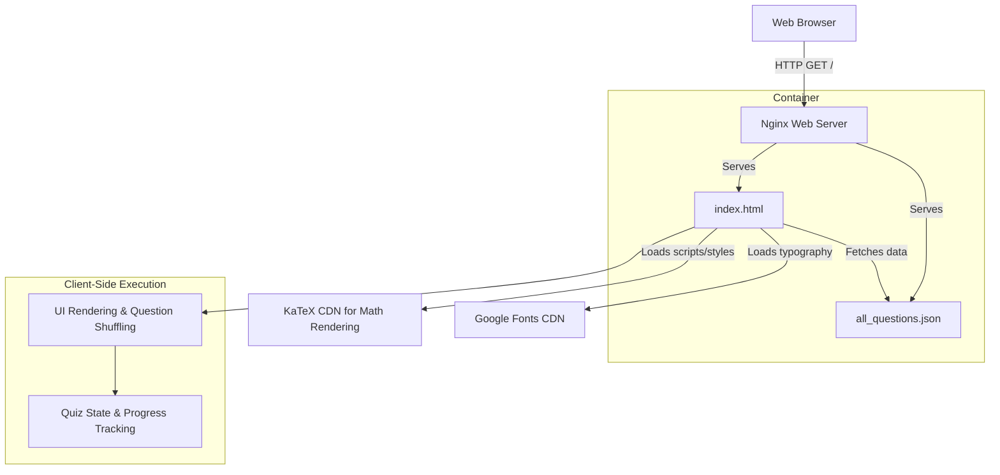

# all-mcq

This repository contains a responsive, static web application for practicing multiple-choice questions (MCQs) and tracking progress.

## System Architecture



## Setup Instructions

Run using Docker Compose for local deployment:

```bash
docker-compose up --build -d
```

## Structure

- `index.html`: The main single-page application and UI logic.
- `all_questions.json`: The static data source containing categorized questions, options, and answers.
- `Dockerfile`: Production-ready, non-root Nginx container configuration.
- `docker-compose.yml`: Orchestration file for local development and deployment.
